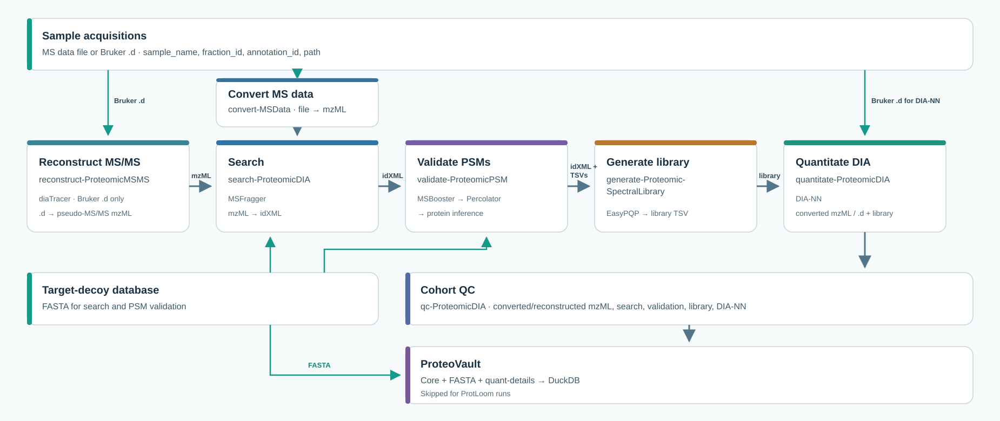

# metapipeline-ProteomicDIA

This Boutros Lab metapipeline converts MS data files to mzML or reconstructs Bruker `.d` acquisitions with diaTracer, searches the resulting mzML files with MSFragger, validates PSMs with MSBooster and Percolator followed by ProtLoom, ProteinProphet, Fido, or Epifany, builds an EasyPQP spectral library, quantifies the cohort with DIA-NN, and summarizes acquisition, identification, library, and quantitation QC. Runs without ProtLoom also build a ProteoVault database after QC.



## Quick start

1. Initialize the child pipelines and shared Boutros Lab modules:

   ```bash
   git submodule update --init --recursive
   ```

2. Prepare the [input CSV](input/template-mzML.csv) with either MS data files supported by the selected conversion algorithm or Bruker `.d` directories, a target-decoy FASTA, and the MSFragger JAR. For `.d` input, also provide the diaTracer JAR and MSFragger `ext/bruker` directory. If selecting ProtLoom, also prepare a [ProtLoom project YAML](config/protloom-project.example.yaml) with the same FASTA and accession markers as the run configuration.
3. Copy [config/template.config](config/template.config) to a run-specific file. Set `input_csv`, `decoy_database`, `msfragger_executable`, `output_dir`, and `dataset_id`. For `.d` input, set `diatracer_executable` and `bruker_lib_dir`. Set `validate_ProteomicPSM.protloom_project_yaml` when using ProtLoom. Review the shared markers and the child-specific settings for your experiment. Keep the template's `includeConfig` lines and final `methods.setup()` call.
4. Run with Nextflow 24.10.6 and its v1 syntax parser. Choose a work directory with enough space for the acquisitions, reconstructed mzML files, and child pipeline work:

   ```bash
   export NXF_VER=24.10.6
   export NXF_SYNTAX_PARSER=v1
   export NXF_WORK=/scratch/$SLURM_JOB_ID/metapipeline-ProteomicDIA-work
   nextflow run main.nf -c /path/to/run.config -profile pines,standard
   ```

The scratch path above is an example for a Slurm job; use another suitable work directory outside Slurm. Select `pines` for a 64 CPU, 500 GB node or `boutroslab_aws` for a 32 CPU, 128 GB node. Add `standard` or `docker` for Docker, `apptainer` for Apptainer, or `singularity` for Singularity, for example `-profile pines,apptainer`. The runtime profile configures the parent ProteoVault process and passes the matching `child_profile` to every child pipeline. `standard` uses Docker by default when no runtime profile is selected. Apptainer and Singularity pull the ProteoVault OCI image through their Nextflow settings. Nextflow's `-c` option adds the run configuration to the project's configuration; see the [Nextflow configuration documentation](https://www.nextflow.io/docs/latest/config.html).

### Resource profiles

| Profile | Node budget | Parent launch processes | Child allocations |
| --- | --- | --- | --- |
| `pines` | 64 CPUs, 500 GB | 2 CPUs, 4 GB per child launcher | diaTracer 12 CPUs/64 GB; MSFragger search 8 CPUs/64 GB; iProphet 8 CPUs/32 GB; DIA-NN 16 CPUs/96 GB; QC DIA-NN report 2 CPUs/32 GB. |
| `boutroslab_aws` | 32 CPUs, 128 GB | 2 CPUs, 4 GB per child launcher | diaTracer 12 CPUs/64 GB; MSFragger search 8 CPUs/64 GB; iProphet 8 CPUs/32 GB; DIA-NN 16 CPUs/96 GB; QC DIA-NN report 2 CPUs/16 GB. |

Parent CSV, conversion and reconstruction manifests, QC manifest, and configuration tasks request 1 CPU and 2 GB in both profiles. ProteoVault requests up to 8 CPUs/64 GB on `pines` and 4 CPUs/32 GB on `boutroslab_aws`. Parent child-launch processes request 2 CPUs and 4 GB from [config/resources.json](config/resources.json). Each profile has its own file under [config/resource_profiles](config/resource_profiles), containing its budget and CPU requests for every child process. A process `memory` value is optional: omit it to leave that child's Nextflow memory directive unset. `search_database_MSFragger` is the exception because it uses `task.memory` to size the Java heap. The profile's `max_memory` remains required as a node budget. The parent passes process requests through each child's parameter JSON and a small resource override config, including conversion, reconstruction, and `qc-ProteomicDIA`. Existing child resource defaults remain in effect when neither profile is selected. A run config can set `base_resource_update` within a child namespace to replace that profile's process requests. These profiles describe node budgets; they do not select a Slurm partition or change the local executor.

For a profile outside the repository, copy [pines.json](config/resource_profiles/pines.json) or [boutroslab_aws.json](config/resource_profiles/boutroslab_aws.json) to a directory you control, rename it `<name>.json`, and edit its budget and allocations. Set these values in your run config:

```groovy
params.compute_profile = 'my_cluster'
params.additional_resource_profile_dir = '/path/to/resource_profiles'
```

Run with `-c /path/to/run.config`; a matching Nextflow `-profile` entry is not required. `additional_resource_profile_dir` can contain multiple directories separated by the operating system's PATH separator (`:` on Linux/macOS). Lookup checks those directories from left to right, then the bundled `config/resource_profiles` directory. Missing directories or missing files in one location are skipped. Relative directories resolve from the launch directory. A profile file found earlier takes precedence over a file of the same name found later. To add a bundled profile, add its name to [config/profiles.config](config/profiles.config) and create `config/resource_profiles/<name>.json`. The shared parent process requests usually do not need to change.

## Inputs

The input CSV requires four columns and accepts an optional `scan` column. Additional columns are allowed and ignored. Use either MS data files or Bruker `.d` directories throughout one run:

```csv
sample_name,fraction_id,annotation_id,path,scan
sample_01,1,reference,/data/sample_01.mzML,
sample_01,2,reference,/data/sample_01_fraction_2.mzML,
sample_02,1,reference,/data/sample_02.wiff,/data/sample_02.wiff.scan
```

| Input | Requirement |
| --- | --- |
| `sample_name` | Biological sample name; repeat it for each fraction. Each sample/fraction pair must be unique. |
| `fraction_id` | Required nonempty fraction identifier. Search, library generation, and quantitation use it to group acquisitions by fraction; it is not appended to the biological sample name. |
| `annotation_id` | Required CSV column; use the same value for every fraction of a sample. When ProtLoom is enabled, it must match an `annotations[].annotation_id` in its project YAML. |
| `path` | Existing MS data file supported by `convert_MSData.convert_algorithm`, or Bruker `.d` directory. Relative paths resolve from the input CSV directory. Paths must be unique. File basenames may repeat across fractions of the same sample; conversion adds fraction suffixes in that case. Basenames shared across samples and Bruker `.d` basenames must remain unique. File basenames cannot contain another dot; Bruker sample and fraction IDs may contain only letters, numbers, underscores, and hyphens. |
| `scan` | Optional column, required for each SCIEX `.wiff` row. Give the companion `.wiff.scan` file path; leave blank for other inputs. Relative paths resolve from the input CSV directory. |
| `decoy_database` | Existing target-decoy FASTA used by search and validation. |
| `msfragger_executable` | Separately obtained MSFragger JAR. |
| `diatracer_executable` | diaTracer JAR, required for `.d` input. |
| `bruker_lib_dir` | MSFragger `ext/bruker` directory containing `libtimsdata-2-21-0-4.so`, required for `.d` input. |
| `validate_ProteomicPSM.protloom_project_yaml` | Required only for the ProtLoom route. The metapipeline supplies its `samples` section from the CSV. |

### ProtLoom project YAML

Start from [config/protloom-project.example.yaml](config/protloom-project.example.yaml). Provide `schema_version: 1`, `annotations` with a unique `annotation_id` and existing GTF file for each annotation, and `database.output_fasta` and `database.output_entries_tsv` pointing to existing files. Set the database decoy and contaminant markers to match the root pipeline parameters. Include `fasta_sources` when this YAML also describes the database sources used by ProtLoom `buildDB`; validation uses the built database outputs and annotations.

Do not maintain a `samples` section in this input file. The metapipeline checks each sample's CSV `annotation_id` against `annotations`, writes `protloom-project.generated.yaml` under the output `manifests/` directory, and passes that file to `validate-ProteomicPSM`. If the input YAML contains an older `samples` section, the generated section is replaced with the CSV mapping. Relative database, GTF, and FASTA source paths are resolved against the original YAML location before the generated file is written.

## Parameters

Set shared values once at the root of the run config. `methods.setup()` derives the child-specific database and decoy settings before writing the child parameter JSON files. The ProtLoom project YAML independently supplies its database markers and must agree with the root values.

| Root parameter | Default | Purpose |
| --- | --- | --- |
| `input_csv` | Required | Sample-to-acquisition CSV (MS data files or `.d`). |
| `decoy_database` | Required | Target-decoy FASTA passed to search and validation. |
| `decoy_string` | `DECOY_` | Decoy accession marker; becomes the MSFragger `decoy_prefix` and validation `decoy_string`. |
| `decoy_position` | `prefix` | Decoy marker position. The current MSFragger search requires `prefix`; validation receives this as `decoy_string_position`. |
| `contam_string` | `CONTAMINANT_` | Contaminant marker; must match `database.contam_string` in the ProtLoom YAML. |
| `contam_position` | `prefix` | Contaminant marker position (`prefix` or `suffix`); must match `database.contam_position` in the ProtLoom YAML. |
| `msfragger_executable` | Required | MSFragger JAR. |
| `reconstruct_nextflow_version` | `25.10.5` | Nextflow runtime for the reconstruction child. |
| `diatracer_executable` | Required for `.d` | diaTracer JAR. |
| `bruker_lib_dir` | Required for `.d` | MSFragger `ext/bruker` directory. |
| `output_dir` | Required | Root directory for published results and logs. |
| `dataset_id` | `cohort` | Name of this cohort's result directory. |
| `child_profile` | `standard` | Nextflow profile applied to each child pipeline run; set with the matching parent `-profile` runtime. |
| `run_proteovault` | `true` | Set to `false` to skip ProteoVault without changing protein inference. |
| `proteovault_version` | `0.2.3` | Version used for the ProteoVault image. |
| `docker_image_proteovault` | `ghcr.io/theboutroslab/proteovault:${params.proteovault_version}` | Image for the parent ProteoVault process. |
| `compute_profile` | Set by `-profile pines` or `-profile boutroslab_aws` | Resource profile name; set directly to select a profile from `additional_resource_profile_dir`. |
| `additional_resource_profile_dir` | None | Optional PATH-style list of directories containing `<compute_profile>.json` files. |

Settings specific to one child belong in its namespace in the run config. The tables below list the parameters relevant to this metapipeline. Values marked **set by metapipeline** are supplied by `methods.setup()` or the child-call process; do not repeat them in a run config. Parent launcher requests are defined in [config/resources.json](config/resources.json), while each child's resource handler controls its internal processes.

### `convert_MSData` — MS data conversion

For file inputs, [convert-MSData](external/convert-MSData/README.md) v1.1.1 produces mzML for search, library generation, quantitation, and QC. The metapipeline passes those mzML files directly to downstream pipelines. Bruker `.d` directories bypass this stage. The default uses ProteoWizard with vendor peak picking; set `convert_MSData.convert_algorithm = 'OpenMS'` for OpenMS conversion. `output_format` must remain `mzML`. Other conversion options, including `peak_picking_vendor`, `peak_picking_openms`, `run_index`, and `pwiz_extra_args`, belong in this namespace. The metapipeline supplies `input_csv` and `output_dir`.

For SCIEX WIFF input, add `scan` to the input CSV and point it at the companion `.wiff.scan` file. The metapipeline validates and passes both paths to conversion. The `scan` column may be omitted for other formats.

| Parameter | Default | Purpose |
| --- | --- | --- |
| `convert_algorithm` | `ProteoWizard` | Select ProteoWizard or OpenMS. |
| `output_format` | `mzML` | Required output format for DIA downstream stages. |
| `peak_picking_vendor` | `true` | Use vendor peak picking. |
| `peak_picking_openms` | `false` | Use OpenMS PeakPickerHiRes. |
| `run_index` | `false` | Reindex converted files with OpenMS FileConverter. |
| `pwiz_extra_args` | `--64` | Extra ProteoWizard arguments. |
| `pwiz_version`, `openms_version` | Child release defaults | Tool versions used by the conversion child. |
| `input_csv`, `output_dir` | Set by metapipeline | Conversion manifest and child output directory. |

### `reconstruct_ProteomicMSMS` — diaTracer reconstruction

For Bruker `.d` input, the metapipeline automatically sends the raw directories to [reconstruct-ProteomicMSMS](external/reconstruct-ProteomicMSMS/README.md). Its pseudo-MS/MS mzML files feed search, validation, library generation, and QC. The original `.d` directories feed DIA-NN quantitation. This stage is skipped for file input. diaTracer options such as `diatracer_delta_apex_im` can be set in the `reconstruct_ProteomicMSMS` namespace; its defaults come from the child pipeline. The bundled resource profiles allocate 12 CPUs and 64 GB to diaTracer. This child runs with Nextflow 25.10.5 by default through `reconstruct_nextflow_version`, while the parent and other children use the documented Nextflow 24.10.6 runtime. The installed `nextflow` launcher must honor `NXF_VER`; the child uses Java 21 or another Java version supported by Nextflow 25.10.5.

### `search_ProteomicDIA` — MSFragger search

The `MSFragger` block uses native `fragger.params` keys. The values below are in [config/template.config](config/template.config); other defaults come from the [search pipeline configuration](external/search-ProteomicDIA/config/default.config).

| `MSFragger` parameter | Template value | Purpose |
| --- | --- | --- |
| `precursor_mass_lower` | `-25` | Lower precursor mass search bound. |
| `precursor_mass_upper` | `25` | Upper precursor mass search bound. |
| `precursor_mass_units` | Child default: `1` | Precursor tolerance units (`1` = ppm). |
| `precursor_true_tolerance` | `4` | Precursor calibration tolerance. |
| `precursor_true_units` | Child default: `1` | Calibration tolerance units (`1` = ppm). |
| `fragment_mass_tolerance` | `50` | Fragment tolerance. |
| `fragment_mass_units` | Child default: `1` | Fragment tolerance units (`1` = ppm). |
| `calibrate_mass` | Child default: `2` | Mass calibration mode. |
| `deisotope` | Child default: `1` | Peak deisotoping mode. |
| `deneutralloss` | Child default: `1` | Neutral-loss peak handling. |
| `isotope_error` | `0/1/2` | Allowed precursor isotope errors. |
| `precursor_mass_mode` | Child default: `selected` | Precursor mass interpretation. |
| `require_precursor` | Child default: `1` | Require precursor evidence. |
| `reuse_dia_fragment_peaks` | Child default: `0` | Whether fragment peaks may match multiple peptides. |
| `fragment_ion_series` | Child default: `b,y` | Fragment ion series. |
| `search_enzyme_name_1` | `stricttrypsin` | Primary enzyme name. |
| `search_enzyme_cut_1` | `KR` | Cleavage residues. |
| `search_enzyme_nocut_1` | Empty | Residues that prevent cleavage. |
| `search_enzyme_sense_1` | `C` | Cleavage terminus. |
| `allowed_missed_cleavage_1` | `2` | Maximum missed cleavages. |
| `num_enzyme_termini` | `2` | Required enzymatic termini. |
| `clip_nTerm_M` | `1` | Permit N-terminal methionine clipping. |
| `variable_mod_01` | `15.9949 M 3` | Methionine oxidation. |
| `variable_mod_02` | `42.0106 [^ 1` | Protein N-terminal acetylation. |
| `allow_multiple_variable_mods_on_residue` | `0` | Multiple variable modifications on one residue. |
| `max_variable_mods_per_peptide` | `3` | Maximum variable modifications per peptide. |
| `output_format` | Child fixed value: `pepXML_pin` | pepXML and PIN needed downstream. |
| `output_report_topN` | `5` | Top PSMs reported per spectrum. |
| `output_max_expect` | Child default: `50` | Maximum expectation value for reported PSMs. |
| `digest_min_length` | `7` | Minimum digested peptide length. |
| `digest_max_length` | `50` | Maximum digested peptide length. |
| `digest_mass_range` | `500.0 5000.0` | Digested peptide mass range in Da. |
| `max_fragment_charge` | `2` | Maximum theoretical fragment charge. |
| `minimum_peaks` | `15` | Minimum spectrum peak count. |
| `use_topN_peaks` | `150` | Maximum experimental peaks retained per spectrum. |
| `min_matched_fragments` | `4` | Minimum matched fragments for a PSM. |
| `add_C_cysteine` | `57.02146` | Fixed cysteine carbamidomethylation mass. |

The child [MSFragger schema](external/search-ProteomicDIA/config/schema.yaml) gives allowed values and validation rules.

### `validate_ProteomicPSM` — MSBooster, Percolator, and protein inference

| Parameter | Template value or source | Purpose |
| --- | --- | --- |
| `run_percolator` | Fixed: `true` | Run MSBooster then Percolator. |
| `percolator_workflow` | Fixed: `msbooster` | Run MSBooster then Percolator. |
| `run_protloom` | Default: `false` | Use ProteinProphet by default; set true for ProtLoom. |
| `protein_inference_algorithm` | Default: `ProteinProphet` | Non-ProtLoom grouping: `ProteinProphet`, `Fido`, or `Epifany` (`Epiphany` alias). |
| `fido_min_probability` | Child default: `0.01` | Minimum Fido group posterior probability for EasyPQP export. |
| `epifany_min_probability` | Child default: `0.01` | Minimum Epifany group posterior probability for EasyPQP export. |
| `epifany_greedy_group_resolution` | Child default: `none` | Optional Epifany shared-peptide resolution: `none`, `remove_associations_only`, or `remove_proteins_wo_evidence`. |
| `docker_image_fido` | Child default: `ghcr.io/theboutroslab/fido:1.0` | Standalone Fido container image. |
| `export_easypqp_reports` | Fixed: `true` | Export cohort PSM and peptide TSVs from the selected route. |
| `merge_consensus` | Fixed: `false` | Search already merges fraction idXML files for each sample; validation receives one search engine per sample. |
| `fractionated` | Automatic | Enabled when the cohort contains more than one fraction ID. |
| `protloom_project_yaml` | Required with ProtLoom | Base project YAML with database files, annotation GTFs, and marker settings; samples are generated from the input CSV. |
| `protloom_pc_order` | `proteotypic` | Peptide-class and protein-tier priorities. |
| `protloom_pt_order` | `canonical` | Peptide-class and protein-tier priorities. |
| `protloom_enzyme` | `trypsin` | ProtLoom cleavage rule. |
| `easypqp_psm_qvalue` | `0.01` | Maximum PSM q-value for EasyPQP export in every inference route. |
| `protloom_easypqp_group_qvalue` | `0.01` | Maximum ProtLoom protein-group q-value for EasyPQP export. |
| `protloom_idxml_primary_score` | `pep` | Primary score in unfiltered ProtLoom idXML. |
| `protloom_idxml_unmatched_psms` | `remove` | Handling of PSMs without a ProtLoom match. |
| `protloom_version` | Metapipeline default: `0.3.1` | ProtLoom version and container. |
| `docker_image_protloom` | Child default: matching image | ProtLoom version and container. |
| `enzyme` | Child default: `Trypsin` | Enzyme used by peptide indexing and Percolator. |
| `skip_peptide_indexing` | Child default: `false` | Skip OpenMS PeptideIndexer when idXMLs are already indexed. |
| `index_peptides_unmatched_action` | Metapipeline default: `remove` | Handling of peptides absent from the FASTA. |
| `index_peptides_aaa_max` | Metapipeline default: `0` | Maximum ambiguous amino acids for peptide indexing. |
| `index_peptides_missing_decoy_action` | Child/OpenMS defaults | Additional peptide-indexing controls. |
| `index_peptides_mismatches_max` | Child/OpenMS defaults | Additional peptide-indexing controls. |
| `index_peptides_IL_equivalent` | Child/OpenMS defaults | Additional peptide-indexing controls. |
| `msbooster_params` | Child bundled file | MSBooster prediction configuration. |
| `percolator_decoy_pattern` | Defaults to `decoy_string` | Decoy protein pattern used for direct Percolator execution. |
| `percolator_post_processing_tdc` | Child default: `true` | Percolator target-decoy competition after rescoring. |
| `filter_psm_score_peptide` | Child default: `0.01` | Final PSM q-value cutoff. |
| `filter_psm_remove_decoys` | Child default: `true` | Exclude decoys from filtered outputs. |
| `filter_psm_keep_unreferenced_protein_hits` | Child default: `false` | Retain or remove unreferenced hits. |
| `filter_psm_delete_unreferenced_peptide_hits` | Child default: `true` | Retain or remove unreferenced hits. |
| `filter_psm_whitelist_proteins` | Child default: no file | Restrict retained protein or peptide hits. |
| `filter_psm_whitelist_peptides` | Child default: no file | Restrict retained protein or peptide hits. |
| `filter_psm_blacklist_proteins` | Child default: no file | Exclude selected protein or peptide hits. |
| `filter_psm_blacklist_peptides` | Child default: no file | Exclude selected protein or peptide hits. |
| `filter_psm_in_silico_digestion` | Child default: no file | FASTA for digestion-based filtering. |

See the [validation pipeline parameters](external/validate-ProteomicPSM/README.md#config) and [OpenMS option mapping](external/validate-ProteomicPSM/docs/params.rst) for the remaining advanced indexing, filtering, and resource controls.

### `generate_ProteomicSpectralLibrary` — EasyPQP library

| Parameter | Template value or source | Purpose |
| --- | --- | --- |
| `fractionated` | Automatic | Enabled when the cohort contains more than one fraction ID; produces one annotated library TSV with `fraction_id`. |
| `idxml_score_type` | `ProtLoom PEP`, or `Posterior Error Probability` when ProtLoom is disabled | Score read from each unfiltered validation idXML hit. |
| `easypqp_score_type` | Metapipeline default: `PEP` | Meaning of the selected score. |
| `easypqp_version` | Child default: `0.1.59` | EasyPQP version and container. |

See the [library pipeline parameter reference](external/generate-ProteomicSpectralLibrary/README.md#inputs).

### `quantitate_ProteomicDIA` — DIA-NN quantitation

| Parameter | Template value or source | Purpose |
| --- | --- | --- |
| `DIA-NN.qvalue` | `0.01` | Main report precursor q-value cutoff. |
| `DIA-NN.matrix_qvalue` | `0.01` | Quantitation matrix q-value cutoff. |
| `DIA-NN.no_ifs_removal` | `true` | Disable fragment interference correction. |
| `DIA-NN.no_prot_inf` | `true` | Disable protein inference for the generated EasyPQP TSV. |
| `docker_image_diann_rpackage` | Child default: `ghcr.io/theboutroslab/diann-rpackage:af538f6` | R image used to aggregate fraction-level quantities; override if using a locally built image. |

Set these in `quantitate_ProteomicDIA { 'DIA-NN' { ... } }`. The metapipeline passes the generated EasyPQP TSV as the child's `library` input and the original acquisition paths as its sample input. For fractionated cohorts, the TSV and quantitation CSV carry `fraction_id`; DIA-NN runs by fraction and the child publishes a final aggregated report and sample-level matrices.

See the [quantitation pipeline parameter reference](external/quantitate-ProteomicDIA/README.md#parameters).

### `qc_ProteomicDIA` — cohort quality control

All `qc_ProteomicDIA` parameters are set automatically by the metapipeline. It passes reconstructed mzML paths and original acquisition paths separately, so Bruker MS1 and acquisition QC use the `.d` directory. QC receives one acquisition row per sample/fraction pair, one identification row per sample, and the final aggregated DIA-NN report.

### ProteoVault — cohort database

After QC, the metapipeline builds and validates the ProteoVault database with the search FASTA. The core build imports the DIA-NN report and published cohort QC table. ProteoVault starts after QC succeeds when `run_proteovault = true` and `validate_ProteomicPSM.run_protloom = false`. Set the root `run_proteovault = false` to skip it independently of protein inference. `proteovault_version` defaults to `0.2.3`; `docker_image_proteovault` uses that version by default. Fractionated DIA runs require a ProteoVault image that supports `sample_name,fraction_id,path` quantitation manifests and sample-level matrix headers.

See [config/template.config](config/template.config) for an editable run configuration and [config/schema.yaml](config/schema.yaml) for root parameter validation.

## Pipeline steps and outputs

1. For file input, `convert-MSData` produces mzML; for `.d` input, `reconstruct-ProteomicMSMS` generates pseudo-MS/MS mzML with diaTracer. `search-ProteomicDIA` searches the resulting mzML with MSFragger and produces idXML files.
2. `validate-ProteomicPSM` uses MSBooster and Percolator, then ProteinProphet by default, Fido or Epifany when selected, or ProtLoom when `validate_ProteomicPSM.run_protloom = true`. Its unfiltered idXML files and cohort PSM and peptide reports feed the library stage.
3. `generate-ProteomicSpectralLibrary` uses those identifications and the search mzML files to produce an EasyPQP library TSV, combining per-fraction libraries into one TSV when needed.
4. `quantitate-ProteomicDIA` quantifies converted mzML files or original Bruker `.d` directories against that library with DIA-NN, running each fraction separately and aggregating sample-level quantities for fractionated cohorts.
5. `qc-ProteomicDIA` summarizes mzML, search, filtered identifications, protein groups, library, and DIA-NN results across the cohort.
6. For ProteinProphet, Fido, and Epifany runs, ProteoVault builds a validated DuckDB database from the core results, search FASTA, full DIA-NN report, and cohort QC table.

Versioned child pipeline directories and the handoff CSVs are published at:

```text
<output_dir>/metapipeline-ProteomicDIA-<version>/
├── <dataset_id>.proteovault.duckdb  # absent for ProtLoom runs
└── <dataset_id>/
    ├── main_workflow/
    │   ├── convert-MSData-1.1.1/  # file input only
    │   ├── reconstruct-ProteomicMSMS-1.0.0/  # .d input only
    │   ├── search-ProteomicDIA-<version>/
    │   ├── validate-ProteomicPSM-<version>/
    │   ├── generate-ProteomicSpectralLibrary-<version>/
    │   ├── quantitate-ProteomicDIA-<version>/
    │   ├── qc-ProteomicDIA-1.3.0/
    │   └── manifests/
    └── log-metapipeline-ProteomicDIA-<version>-<timestamp>/
```

The metapipeline creates each stage's input CSV in `manifests/`. It writes one search mzML and one library mzML row per fraction, one merged validation and library idXML row per sample, and one quantitation row per raw acquisition. For fractionated cohorts, quantitation CSV includes `fraction_id` and the QC caller writes one acquisition row per sample/fraction. The combined QC table is in `qc-ProteomicDIA-1.3.0/<dataset_id>/output/<dataset_id>_QC_metrics.tsv`, alongside per-sample identification tables, per-fraction acquisition and MS1 outputs, PSM feature summaries when available, and MS1 HTML plots. The child directories contain the scientific results and their own logs. When produced, the ProteoVault database contains the core quantitation, FASTA, and QC data. It is published at the versioned metapipeline root, which is the directory to supply as `--pipeline-output` when updating recorded paths. ProteoVault records source paths from the build work directory; the metapipeline does not rewrite paths inside the DuckDB file when publishing it. The timestamped metapipeline log directory contains the parent Nextflow reports and effective parameters.

## Testing

The NFTest cases run conversion for file inputs and the downstream child pipelines using ProtLoom, ProteinProphet, or Epifany for validation; the ProteinProphet and Epifany cases also run ProteoVault. From the repository root, inside a Slurm job, copy `.env-template` to `.env`, set `TEST_DATA_DIR`, and run:

```bash
zsh test/run-nftest.sh test_integration_MSFragger_ProtLoom_DIANN
zsh test/run-nftest.sh test_integration_MSFragger_ProteinProphet_DIANN
zsh test/run-nftest.sh test_integration_MSFragger_ProteinProphet_DIANN_multifraction
zsh test/run-nftest.sh test_integration_MSFragger_Epifany_DIANN
zsh test/run-nftest.sh test_integration_MSConvert_MSFragger_ProteinProphet_DIANN
```

The test runner uses `/scratch/$SLURM_JOB_ID/<test-case>` for its work and output. The test CSV and ProtLoom project YAML expand `$TEST_DATA_DIR` through [test/csv_environment_expander.groovy](test/csv_environment_expander.groovy).

## License

This pipeline is licensed under GNU GPL version 2. See [LICENSE](LICENSE).
