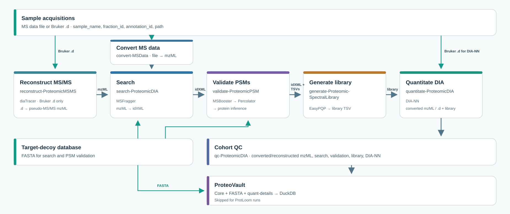

# SpectroMesa-DIA overview

SpectroMesa-DIA is designed to support most major data-independent acquisition (DIA) proteomics data types, including Thermo RAW (`.raw`), SCIEX SWATH (`.wiff`), and Bruker diaPASEF (`.d`), across both unfractionated and fractionated experiments.

The pipeline uses **Nextflow** to orchestrate individual tools and analysis steps. [1](#ref-1) It follows a spectrum-based approach similar to **FragPipe**, involving database searching, peptide-spectrum match (PSM) validation, protein grouping, spectral library generation, and peptide and protein quantitation. [6](#ref-6)

## Workflow

*MS data files pass through conversion, while Bruker `.d` acquisitions pass through MS/MS reconstruction. Both routes feed search, validation, and library generation. DIA-NN quantifies converted mzML files or the original Bruker acquisitions using the resulting library. QC follows quantitation, with optional ProteoVault database assembly afterward.*

## Major components

### MS data preparation

For file inputs, **ProteoWizard msconvert** produces mzML for downstream analysis; **OpenMS** provides an alternative conversion route for supported formats. For Bruker diaPASEF data, **diaTracer** reconstructs precursor-resolved pseudo-MS/MS spectra for peptide identification. The original Bruker acquisitions are retained for quantitation rather than being replaced by those reconstructed spectra. [2](#ref-2), [3](#ref-3), [4](#ref-4)

### Peptide identification

**MSFragger** searches the prepared spectra against a target-decoy protein sequence database to generate candidate peptide-spectrum matches (PSMs). Its DIA search capabilities support identification from complex DIA spectra, while the Bruker route supplies spectra reconstructed by diaTracer. These candidate identifications are then evaluated by the validation stage. [5](#ref-5), [6](#ref-6)

### Identification validation and protein inference

**MSBooster** adds features derived from predicted peptide properties, and **Percolator** uses them to rescore PSMs and estimate identification confidence. Protein inference then relates peptide evidence to protein groups: **ProteinProphet** is the default, with **Fido** and **EPIFANY** available as alternatives. [7](#ref-7), [8](#ref-8), [9](#ref-9), [10](#ref-10), [11](#ref-11)

### Spectral library generation

**EasyPQP** combines the identified peptides with their observed spectra to build a cohort spectral library for DIA-NN. It uses the accepted PSM and peptide reports from validation, preserving the selected protein assignments. For fractionated cohorts, the workflow builds libraries by fraction and combines them while retaining fraction information.

### DIA quantitation

!!! important "Upstream protein groups are retained"
    **DIA-NN** is used for quantitation only, with its protein inference disabled by default. It quantifies peptides and proteins using the generated spectral library while retaining the protein groups assigned upstream by **ProteinProphet**, **Fido**, or **EPIFANY**.

DIA-NN receives converted mzML files for the file-input route and the original `.d` acquisitions for the Bruker route; fractionated analyses run quantitation by fraction and aggregate the results into sample-level reports and abundance matrices. [12](#ref-12)

### Quality control

The DIA QC pipeline uses **pyOpenMS** and dedicated summary scripts to examine acquisition data, search and validation results, protein inference, the spectral library, and DIA-NN quantitation. Cohort QC tables and interactive MS1 plots help inspect signal quality and variation across samples and fractions; Bruker acquisition QC uses the original `.d` data. [2](#ref-2)

### Results database

**[ProteoVault](https://github.com/TheBoutrosLab/package-ProteoVault)** optionally combines the DIA-NN report, protein sequence database, and cohort QC results into a validated **DuckDB** database. This provides a common entry point for querying the cohort alongside the published library and quantitative outputs. Database assembly is currently available for the ProteinProphet, Fido, and EPIFANY routes. The generated DuckDB database can be imported and analyzed in R using [ProteoVaultR](https://github.com/TheBoutrosLab/package-ProteoVaultR).

## References

1. **Nextflow:** Di Tommaso P et al. (2017). Nextflow enables reproducible computational workflows. *Nature Biotechnology*. [doi:10.1038/nbt.3820](https://doi.org/10.1038/nbt.3820).
2. **OpenMS:** Pfeuffer J et al. (2024). OpenMS 3 enables reproducible analysis of large-scale mass spectrometry data. *Nature Methods*. [doi:10.1038/s41592-024-02197-7](https://doi.org/10.1038/s41592-024-02197-7).
3. **ProteoWizard:** Kessner D et al. (2008). ProteoWizard: open source software for rapid proteomics tools development. *Bioinformatics*. [doi:10.1093/bioinformatics/btn323](https://doi.org/10.1093/bioinformatics/btn323).
4. **diaTracer:** Li K et al. (2025). diaTracer enables spectrum-centric analysis of diaPASEF proteomics data. *Nature Communications*. [doi:10.1038/s41467-024-55448-8](https://doi.org/10.1038/s41467-024-55448-8).
5. **MSFragger:** Kong AT et al. (2017). MSFragger: ultrafast and comprehensive peptide identification in mass spectrometry-based proteomics. *Nature Methods*. [doi:10.1038/nmeth.4256](https://doi.org/10.1038/nmeth.4256).
6. **MSFragger-DIA:** Yu F et al. (2023). Analysis of DIA proteomics data using MSFragger-DIA and FragPipe computational platform. *Nature Communications*. [doi:10.1038/s41467-023-39869-5](https://doi.org/10.1038/s41467-023-39869-5).
7. **MSBooster:** Yang KL et al. (2023). MSBooster: improving peptide identification rates using deep learning-based features. *Nature Communications*. [doi:10.1038/s41467-023-40129-9](https://doi.org/10.1038/s41467-023-40129-9).
8. **Percolator:** Käll L et al. (2007). Semi-supervised learning for peptide identification from shotgun proteomics datasets. *Nature Methods*. [doi:10.1038/nmeth1113](https://doi.org/10.1038/nmeth1113).
9. **ProteinProphet:** Nesvizhskii AI et al. (2003). A statistical model for identifying proteins by tandem mass spectrometry. *Analytical Chemistry*. [doi:10.1021/ac0341261](https://doi.org/10.1021/ac0341261).
10. **Fido:** Serang O, MacCoss MJ, Noble WS (2010). Efficient marginalization to compute protein posterior probabilities from shotgun mass spectrometry data. *Journal of Proteome Research*. [doi:10.1021/pr100594k](https://doi.org/10.1021/pr100594k).
11. **EPIFANY:** Pfeuffer J et al. (2020). EPIFANY: a method for efficient high-confidence protein inference. *Journal of Proteome Research*. [doi:10.1021/acs.jproteome.9b00566](https://doi.org/10.1021/acs.jproteome.9b00566).
12. **DIA-NN:** Demichev V et al. (2020). DIA-NN: neural networks and interference correction enable deep proteome coverage in high throughput. *Nature Methods*. [doi:10.1038/s41592-019-0638-x](https://doi.org/10.1038/s41592-019-0638-x).
